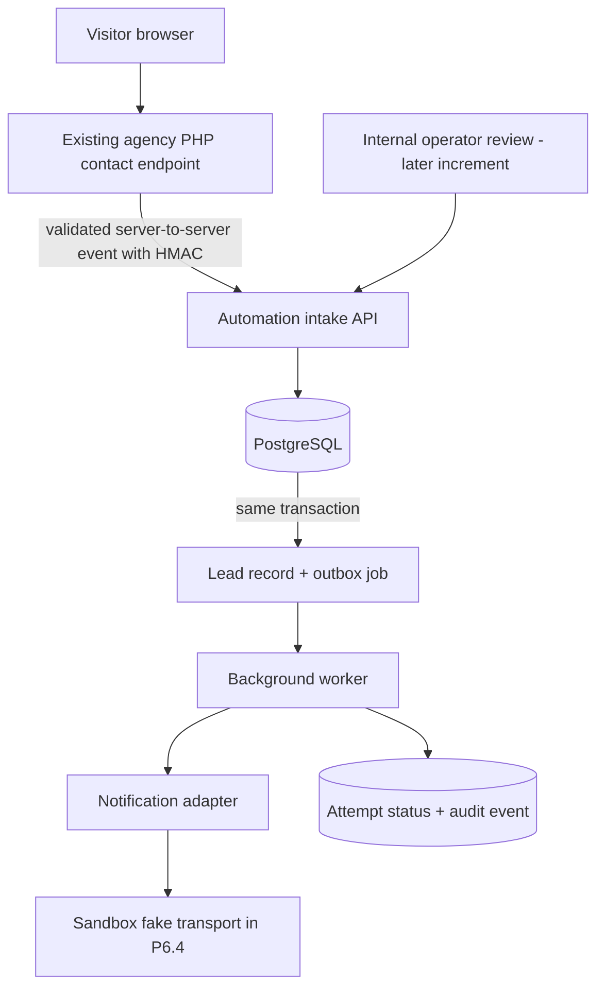

# Phase 6 — MVP Selection Proposal and Architecture

**Decision status:** OWNER-APPROVED FOR P6.4 SANDBOX IMPLEMENTATION ONLY. Production integration and release remain unapproved.  
**Phase package:** P6.3 — MVP selection and architecture.  
**Baseline:** `main` after PR #33 at `84e7843e2e7415018c858272a061ae0c13b7ccc2`; 7 November 2026.  
**Related documents:** `docs/PHASE_6_EXECUTION_PLAN.md`, `docs/PRODUCT_AUTOMATION_GOVERNANCE.md`, `docs/LAUNCH_READINESS_CHECKLIST.md`.

## 1. Executive proposal

Recommend a narrow **Lead Intake Routing & Internal Notification** workflow as the first internal pilot (working description, not an approved product brand).

The pilot receives a validated agency inquiry event, persists it, creates a durable notification job, and sends an internal alert through a replaceable notification adapter. An internal operator can inspect the event and its delivery state in a later increment. It does not automatically reply to the lead, publish content, send SMS, write to a CRM, or perform any irreversible external action.

This is deliberately an **internal-first workflow vertical slice**, not a claim that customer demand has already been proven and not a launch-ready customer-facing SaaS product. The repository contains a PHP contact endpoint, but no approved customer-demand dataset, usage analytics or verified third-party automation provider. Therefore:

- The technical fit is supported by the existing inquiry route.
- External market/customer demand remains unknown.
- The owner approved the internal-first lead-intake workflow for the P6.4 sandbox implementation on 7 November 2026. This does not approve real customer data, production integration, provider selection, hosting spend or public release.
- If the owner has a different high-priority customer workflow with evidence, replace this proposal before implementation.

## 2. Why this is the recommended first pilot

### Existing repository evidence

The current `contact.php` endpoint:
- validates form fields and the allowed service values;
- checks session CSRF, same-origin behavior and a honeypot;
- applies a per-session submission limit;
- attempts immediate PHP `mail()` delivery when the server-only configuration is present;
- returns an explicit failure when mail is not configured or the host mail call fails.

The current endpoint does **not** include a durable lead database, notification outbox, background worker, retry/dead-letter state, operator review queue or automation execution history. The existing browser copy/download fallback is local-only and is not a server-side workflow.

### Fit versus the other candidates

| Candidate | First-MVP assessment | Reason for not selecting it first |
|---|---|---|
| Notifications & SMS | Useful capability, but broad until a single trigger and recipient are defined | Sender/provider availability, consent, opt-out, regional delivery, pricing and deliverability need provider-specific validation |
| Social publishing | High external value for some teams | Platform app review, scopes, content policy, token lifecycle and publishing permissions create a large initial dependency |
| Generic API/webhook workspace | Strong reusable platform primitive | Too broad as the first customer workflow; endpoint abuse, tenant isolation, event replay and durable processing expand the MVP before a clear user problem is validated |
| AI agent workflows | Flexible, but difficult to bound | Prompt injection, tool permissions, evaluation, model data handling and variable operating costs make the first release harder to control |
| E-commerce workflows | Potentially valuable in operations teams | Merchant authorization, customer/order data, platform-specific policy and duplicate writes increase consequence and recovery risk |
| **Lead intake routing & internal notification** | **Recommended internal-first pilot** | Reuses an existing site task, starts with one event and one internal destination, can be tested without customer provider accounts or automated outbound actions |

No unsupported numerical score is assigned. Customer demand, provider access, runtime cost and external support requirements remain unknown until verified.

## 3. Proposed MVP boundary

### Included in the sandbox vertical slice

1. Accept a versioned lead-submitted event from a trusted server-side source.
2. Validate schema, size, event time and a unique idempotency key.
3. Persist a minimal inquiry record and an internal notification outbox job in one database transaction.
4. Return an accepted response only after the durable transaction commits.
5. Process outbox jobs asynchronously through a worker.
6. Use a deterministic fake notification adapter during P6.4; no real email/SMS leaves the sandbox.
7. Record state transitions, attempts and sanitized failure codes.
8. Prove duplicate-event protection, bounded retries, dead-letter behavior and audit events with automated tests.

### Explicitly excluded

- Customer accounts, organization workspaces, invitations and role management.
- Multi-tenant self-service configuration.
- CRM integrations, external ticketing systems or messaging-provider integrations.
- SMS, WhatsApp, social publishing, ecommerce writes or AI agent actions.
- Automatic customer acknowledgements or follow-up messages.
- Browser-side API secrets, customer credential collection or OAuth.
- Billing, checkout, licensing, subscriptions and paid usage.
- Production deployment, live inbox delivery or public “available” claims.

The first pilot remains single-tenant and internal. Phase 7 remains responsible for the general customer account, billing and entitlement platform.

## 4. Proposed architecture

### Logical flow



The agency marketing website remains a separate presentation/deployment unit. The automation runtime is independently deployable and must not assume that PHP shared hosting can run a durable worker.

### Recommended logical components

| Component | Proposed responsibility | Boundary |
|---|---|---|
| Intake API | Authenticate trusted source, validate event, enforce idempotency and commit durable intake | Server-to-server only; never called with a shared secret from browser JavaScript |
| Workflow domain | Own lead state, allowed transitions and notification decision | One narrow workflow; no generic visual workflow builder |
| PostgreSQL | Persist leads, idempotency records, outbox jobs and audit events | Durable source of truth; schema migrations and backup/restore required |
| Outbox worker | Lease due jobs, dispatch adapter, record attempts, schedule retry or dead-letter | Separate process; bounded concurrency and shutdown handling |
| Notification adapter | Abstract internal alert delivery behind a replaceable interface | Fake transport in P6.4; production provider not selected |
| Operator review | Inspect delivery state and manually decide follow-up | Internal-only; authentication/authorization design required before UI exposure |

### Recommended implementation shape

- **Backend:** TypeScript/Node.js modular monolith, with separate API and worker entry points from the same codebase.
- **Persistence:** PostgreSQL for durable records and a transactional outbox.
- **Queue approach for the first pilot:** PostgreSQL-backed outbox with row leasing/locking. Do not add Redis or a separate queue service unless measured throughput, scheduling or operational requirements justify it.
- **Provider abstraction:** `NotificationTransport` interface; deterministic fake adapter for P6.4. Choose SMTP/API provider only after region, price, sender authentication, deliverability, privacy terms and operational requirements are checked.
- **Configuration:** environment/secret manager values on the server; no secrets in HTML, browser storage, repo files, logs or test fixtures.
- **Deployment:** none selected. Before a live pilot, verify an always-on API and worker runtime, PostgreSQL connectivity, TLS, secrets, backups, logs/metrics and recovery. The future Hostinger marketing-site plan is not automatically the automation runtime.

This is an architecture recommendation, not a binding choice of cloud vendor, mail provider or paid plan.

## 5. Event contract and API outline

### Inbound event

Proposed endpoint:

`POST /v1/intake/lead-submitted`

The source is a trusted server-side integration. The browser never receives the HMAC secret or calls the private intake endpoint directly.

Illustrative event shape (synthetic data only):

```json
{
  "schema_version": 1,
  "event_id": "7e16d8a2-0aef-4f4b-9ca6-2d0a5fc1a9c7",
  "occurred_at": "2026-11-06T12:00:00Z",
  "source": "agency-contact-form",
  "lead": {
    "name": "Example Visitor",
    "email": "visitor@example.invalid",
    "service": "AI, LLM & intelligent automation",
    "message": "Synthetic test inquiry for workflow validation."
  }
}
```

The event is illustrative only; `example.invalid` is reserved for test data and must not be used as a recipient.

### Authentication and replay protection

- Require TLS.
- Sign the exact request body using an HMAC scheme with timestamp and key identifier headers.
- Validate timestamp tolerance, signature in constant time and an allowlisted source identity.
- Keep signing keys server-side; support rotation with a short overlap window.
- Enforce a unique `event_id`/idempotency key in the database.
- Reject oversized bodies, unsupported schema versions, invalid fields and requests outside rate limits.
- Do not treat browser Origin/Referer checks as API authentication.

Exact signature header names and canonicalization are to be fixed in P6.4 interface tests before the PHP adapter is changed.

### Responses

- `202 Accepted` only after the lead and outbox record commit successfully.
- `409 Conflict` or a documented idempotent success response for a duplicate event; choose one behavior and test it consistently.
- `400/422` for malformed or semantically invalid payloads.
- `401/403` for missing/invalid source authentication.
- `429` for rate limiting.
- `5xx` for persistence failure; the source must retain/retry according to a bounded policy rather than silently discard the inquiry.

The live PHP contact endpoint must not be modified to forward events until failure behavior and a safe fallback path are designed and tested. The sandbox uses generated events only.

## 6. Persistence model

Proposed minimum tables:

| Table | Important fields | Purpose |
|---|---|---|
| `leads` | `id`, `source`, `event_id`, `name`, `email`, `service`, `message`, `received_at`, `status` | Minimal lead record and workflow state |
| `outbox_jobs` | `id`, `lead_id`, `job_type`, `idempotency_key`, `status`, `attempt_count`, `available_at`, `locked_at`, `last_error_code` | Durable asynchronous notification intent |
| `delivery_attempts` | `id`, `job_id`, `attempt_number`, `started_at`, `finished_at`, `outcome`, `sanitized_error_code` | Operational retry history without storing secrets |
| `audit_events` | `id`, `actor_type`, `actor_id`, `action`, `entity_type`, `entity_id`, `occurred_at`, `metadata` | Trace state changes and operator actions |

Required constraints:
- Unique `event_id` for the source namespace.
- Unique outbox idempotency key for each intended notification.
- Foreign keys between leads, jobs and attempts.
- Explicit enum/check constraints for state transitions.
- No raw authorization headers, HMAC keys, full request bodies or mail credentials in logs/audit metadata.
- Retention period and deletion procedure must be approved before any real personal data is stored.

A transactional outbox prevents the lead record and notification intent from diverging when the API process stops between writes. Delivery is at-least-once at the worker boundary; idempotency and provider capabilities must prevent duplicate effects where possible. Do not promise universal exactly-once delivery.

## 7. Workflow state machine and failure policy

Proposed outbox states:

`pending → processing → sent`

Recoverable failures return to `pending` with a future `available_at`. Exhausted or non-retryable failures move to `dead_letter`. A worker lease must expire safely so a crashed worker does not leave jobs permanently stuck in `processing`.

Initial sandbox policy (tunable after testing):
- Bounded attempts (proposed maximum: 5).
- Exponential backoff with jitter.
- Per-job timeout and bounded worker concurrency.
- Redacted error codes; raw provider responses are not copied into customer-visible logs.
- Dead-letter records remain visible to an authorized operator for inspect/retry/discard.
- Manual retry creates an audit event and does not erase the earlier attempt history.

The sandbox fake transport should deterministically simulate success, transient failure, permanent failure, timeout and duplicate delivery.

No automatic response is sent to the lead. Human review remains responsible for deciding what to do next.

## 8. Privacy, security and abuse controls

- Collect only name, reply email, selected service, message and timestamps needed for inquiry handling.
- Define and approve a retention period before accepting production submissions.
- Use TLS in transit and storage encryption appropriate to the selected database/runtime provider.
- Keep application secrets outside the repository, browser and logs; rotate signing keys.
- Apply server-side schema validation, request-size caps, rate limits and source authentication.
- Never render user-supplied message content as trusted HTML; escape it in any operator UI.
- Restrict operator access; require authenticated server-side authorization and log review actions.
- Do not use lead content to train models or send it to an LLM in this MVP.
- Document backup access, deletion requests, incident handling and support ownership before live use.
- Test duplicate, replayed, malformed, oversized and unauthenticated events.

## 9. Acceptance tests for P6.4 sandbox

The first implementation is accepted only when tests prove:

1. A valid synthetic inquiry is accepted and durably stored.
2. Lead and outbox writes are atomic: forced transaction failure leaves neither partial record.
3. Replaying the same event cannot create duplicate lead or notification intent.
4. Invalid signatures, stale timestamps, malformed payloads and oversized requests are rejected.
5. A fake transport success marks the job sent and records an attempt/audit event.
6. Transient failure schedules retry; permanent/exhausted failure dead-letters.
7. Worker crash/expired lease recovers without losing the job.
8. Concurrent workers do not process the same leased job simultaneously.
9. Logs and errors do not expose email/message payloads, tokens or secrets.
10. No network call to a real mail/SMS/provider endpoint is made in sandbox tests.
11. State transitions are validated and audited.
12. Local, CI and migration tests are deterministic and do not require paid services.

## 10. Runtime and operating cost decision

No production host, provider or monthly budget is approved by this document.

Before a live pilot, obtain and compare actual provider quotes/terms for:
- always-on API and worker compute;
- PostgreSQL storage, backups and connection limits;
- outbound email delivery and sender authentication;
- log/metric retention and alerting;
- secret storage and key rotation;
- expected volume, retry amplification and support time.

The public website can be purchased/deployed on Hostinger near launch as planned. The automation runtime must be hosted wherever a continuously available API, worker, database, secrets and monitoring can be operated safely. Do not buy a second service until a technical comparison and owner approval exist.

## 11. Decision record

| Decision | Proposed value | Status |
|---|---|---|
| First workflow | Lead intake routing and internal notification | Proposed; owner approval required |
| Pilot mode | Single-tenant, agency-internal first | Proposed |
| Primary benefit | Durable intake and observable internal notification instead of relying only on immediate mail handoff | Technical hypothesis; measure during pilot |
| Backend shape | TypeScript/Node modular monolith with API and worker | Proposed |
| Database | PostgreSQL | Proposed |
| Queue | Transactional outbox in PostgreSQL for first low-volume pilot | Proposed |
| Notification transport | Fake transport in sandbox; provider undecided for live use | No provider approved |
| Website integration | No change to live `contact.php` until reliable fallback/forwarding semantics are proven | Required boundary |
| Multi-tenancy | Excluded from first pilot | Proposed |
| External actions | Internal notification only; no automatic customer response | Proposed |
| Hosting/provider spend | None approved | Not selected |
| Public product status | Planned / in development only | Must remain non-live |

### Owner decision record

**Approved on 7 November 2026:** the owner selected the internal-first Lead Intake Routing & Internal Notification MVP and authorized P6.4 sandbox implementation.

Approval is limited to synthetic test events, a separate Node.js/TypeScript API and worker, PostgreSQL persistence, the transactional outbox, and deterministic fake notification outcomes. It does **not** authorize:
- modifying the live PHP contact endpoint or forwarding real inquiries;
- storing real customer or personal data in this runtime;
- selecting or connecting email, SMS or other providers;
- production hosting, paid infrastructure, external accounts or deployment;
- a public customer-facing SaaS claim or release.

P6.5/P6.6 and any live pilot require their own security, privacy, runtime and release decisions.

Merging this architecture document does not silently mark customer demand as proven, select a paid provider, authorize production credentials or authorize deployment.

## 12. Subsequent work

- **P6.4:** implement the synthetic-event API, PostgreSQL schema/outbox and deterministic fake transport in a sandbox branch, after owner approval.
- **P6.5:** add the minimum internal review/monitoring controls and access model; customer-facing accounts remain out of scope.
- **P6.6:** security/privacy/operations acceptance, runtime selection and a separate release decision before any live listing.
